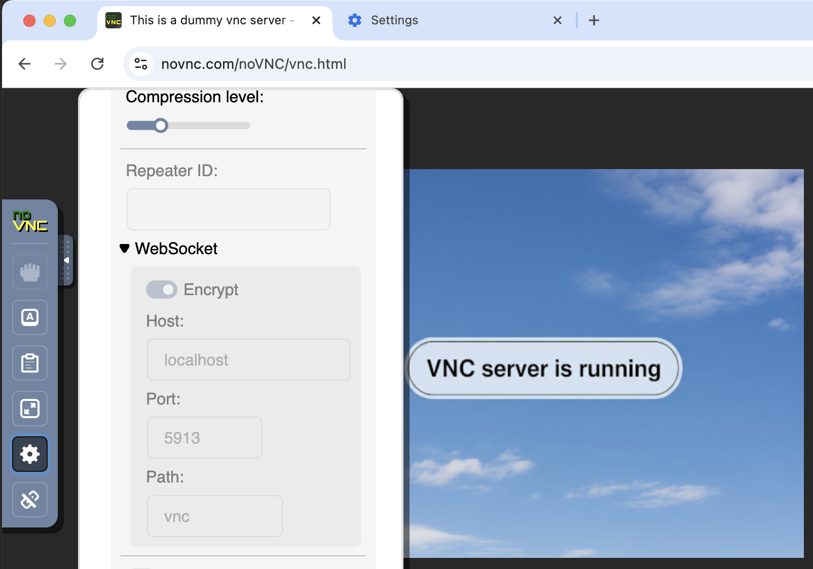

# FictusVNC Server

A minimal VNC server that serves a static image.


---

## ⚙️ Features

- 🖼 Serve static JPG & PNG as framebuffer
- 🖥 Supports websocket-based clients clients (noVNC)
- 🔓 SSL connection
- 💾 Cross-platform: Linux, Windows, macOS, ARM64
- 📉 Lightweight: ~9.2MB binary

---

## 🚀 Quick Start

- [▶️ Run from command line](#run-from-command-line)
- [▶️ Run in a container](#run-in-a-container)
- [🗂 Preview](#preview)

---

## Run from command line

```bash
./fictusvnc-linux-amd64 -certfile cert.pem -keyfile key.pem  -image ./images/default.png -port 5900 -servername "Test server"
```

---

### Available Flags

| Flag              | Description       | Default Value          |
| ----------------- | ----------------- | ---------------------- |
| `-port`           | Port to listen on | 5900                   |
| `-certfile`       | Certificate file  | ``                     |
| `-keyfile`        | Key file          | ``                     |
| `-image`          | Image to display  | `./images/default.png` |
| `-servername`     | VNC server name   | `Mock VNC server`      |

---

## Run in a container

Run on default port (5900). Non-secure http. Show built-in image.
```
docker build -t fictusvnc_websocket:latest -f Dockerfile .
docker compose build
docker compose up -d fictusvnc_websocket
```

Customise everything.
Change port. Show custom image. Certificate and key to serve TLS.
```
docker build -t fictusvnc_websocket:latest -f Dockerfile .
docker compose build
export FICTUSVNC_SERVER_NAME="This is a dummy vnc server"
export FICTUSVNC_IMAGE=custom_image.png
export FICTUSVNC_PORT=5913
export FICTUSVNC_CERTFILE=mycert.pem
export FICTUSVNC_KEYFILE=mykey.pem
docker compose up -d fictusvnc_websocket
```

---

## Preview



---

## License

This project is licensed under the terms specified in the [LICENSE](LICENSE) file.
